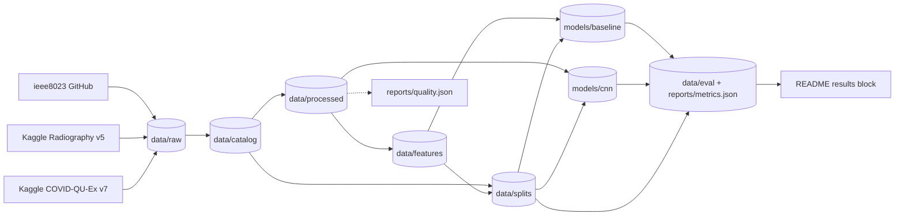

# COVID-19 X-ray Pipeline

> A reproducible DVC pipeline that turns three public chest X-ray datasets into a leakage-safe
> COVID-19 vs normal benchmark: classical features and a small CNN, compared on the same splits.

[](https://github.com/emanuel-luis/covid19-xray-pipeline/actions/workflows/ci.yml)
[](https://github.com/emanuel-luis/covid19-xray-pipeline/actions/workflows/security.yml)
[](LICENSE)


The project started as a 2022 research notebook (two papers at ERCEMAPI 2022, see
[Publications](#publications)). It is now one DVC pipeline with typed table contracts, run
metadata on every stage and a CI that runs the whole DAG on synthetic images. The 2022 research
text, in Portuguese, is in [README.pt-BR.md](README.pt-BR.md).

## What this demonstrates

- Layered data flow: raw, catalog, processed, features, splits, models, evaluation. Each layer
  has one owner stage, one directory and a documented contract ([docs/DATA.md](docs/DATA.md)).
- Idempotent stages: outputs are written to a temporary directory and swapped in atomically, then
  `_run.json` is written last, so a half-written layer is detectable and a rerun is safe.
- Typed contracts: every table is validated against a pyarrow schema before it is written, and
  rows a stage cannot use go to a rejects table with a reason instead of being dropped silently.
- Run metadata: each stage records run id, timings, row counts, rejects and a hash of its
  parameters; source downloads record sha256 per file, version and license in a manifest.
- Reproducibility: pinned source versions, a locked environment (`uv.lock`), seeded and
  deterministic stages, and `dvc repro` as the single entry point.
- Leakage-safe evaluation: exact and near-duplicate images are clustered, linked to patients and
  kept in one group; splits are stratified and group-aware; scalers are fitted on train only;
  metrics are reported per model family, split and source.
- Resumable GPU training: the CNN stage writes an atomic checkpoint after every epoch, keyed on
  its inputs, and resumes at the next epoch after an interruption.

## Architecture



## Tech stack

Python 3.12 · DVC · uv · pandas · pyarrow · OpenCV · scikit-image · mahotas · scikit-learn ·
PyTorch and torchvision (optional extra) · pytest and hypothesis · ruff and mypy (strict) ·
GitHub Actions.

## Quickstart

```bash
git clone https://github.com/emanuel-luis/covid19-xray-pipeline && cd covid19-xray-pipeline
make install     # uv sync --locked (no torch)
make demo        # the whole pipeline on synthetic images, written to .demo/ (installs the cnn extra)
make pipeline    # dvc repro on the real sources, then the README results block
```

`make demo` needs no credentials and no download of datasets. `make pipeline` fetches the real
datasets. The two Kaggle sources need an API token: set `KAGGLE_API_TOKEN`, or save the token in
`~/.kaggle/access_token`. The legacy `~/.kaggle/kaggle.json` still works. The token never goes
into the repository.

The CNN is an optional extra (`make install-cnn`, or `uv sync --extra cnn`). It installs CPU wheels
on Linux and CUDA 13.0 wheels on Windows, which download about 3 GB. Without the extra, set
`train_cnn.enabled: false` and the pipeline runs the classical baseline only.

## Pipeline stages

| Stage | Input | Output | Contract and quality checks |
| --- | --- | --- | --- |
| ingest | pinned source versions in `params.yaml` | `data/raw/<source>` | `_manifest.json` with sha256 per file, license and citation; skipped when the manifest matches |
| catalog | `data/raw` | `data/catalog` | content-hash `image_id`; exact duplicates collapsed; near-duplicate clusters; patient-aware `group_id`; rejects for missing, undecodable and label-conflicting files |
| process | catalog | `data/processed`, `reports/quality.json` | resize and pad to a square, optional CLAHE; rejects for preprocessing errors; quality report |
| features | processed images | `data/features` | 119 handcrafted features, all finite float64; rejects for non-finite values |
| split | catalog, features | `data/splits` | stratified, group-aware train, val and test; fails if a group straddles splits or a split lacks a class |
| train_baseline | features, splits | `models/baseline` | scaler inside the sklearn pipeline, fitted on train; candidate chosen on validation F1 |
| train_cnn | processed images, splits | `models/cnn` | ResNet-18 transfer learning; per-epoch checkpoints; can be disabled |
| evaluate | splits, both model families | `data/eval`, `reports/metrics.json` | metrics per family, split and source; fixed 0.5 threshold |
| report | `reports/metrics.json` | README results block | `covidxr report --check` fails on a stale block |

## Project structure

```
src/covidxr/        pipeline code: one module per stage, contracts, config, CLI
  sources/          source adapters (ieee8023, Kaggle, synthetic)
  training/         baseline and CNN training
tests/              unit, end-to-end (synthetic) and external (network) tests
docs/               DATA.md, DECISIONS.md, REFACTOR_PLAN.md
notebooks/legacy/   the 2022 notebook, unchanged
dvc.yaml            the stage graph
params.yaml         every tunable value; params.ci.yaml is the synthetic profile for CI
```

## Results (pipeline)

<!-- covidxr:metrics:start -->
Not generated yet: run `make pipeline`.
<!-- covidxr:metrics:end -->

## Results (2022 notebook)

The 2022 notebook fitted the scaler before the split and left out one source, so these numbers
are not comparable with the pipeline results above.

| Model | F1 | Accuracy | Specificity | Recall | Precision |
| --- | --: | --: | --: | --: | --: |
| MLPClassifier | 0.9637 | 0.9692 | 0.9710 | 0.9668 | 0.9605 |
| XGBClassifier | 0.9551 | 0.9621 | 0.9663 | 0.9564 | 0.9539 |
| SVC | 0.9469 | 0.9554 | 0.9637 | 0.9440 | 0.9499 |
| LGBMClassifier | 0.9408 | 0.9499 | 0.9546 | 0.9434 | 0.9382 |

The full table for all ~10 models is in the notebook (`notebooks/legacy/`).

## Datasets

Versions are pinned in `params.yaml`. Licenses, citations and how labels are derived are in
[docs/DATA.md](docs/DATA.md). Images and derived data are never committed.

| Source | Pinned version | License |
| --- | --- | --- |
| [Covid-ChestXray-Dataset](https://github.com/ieee8023/covid-chestxray-dataset) | commit 7854329 | metadata CC BY-NC-SA 4.0, per-image licenses in the metadata |
| [COVID-19 Radiography Database](https://www.kaggle.com/datasets/tawsifurrahman/covid19-radiography-database) | Kaggle version 5 | academic and non-commercial use, see the Kaggle page |
| [COVID-QU-Ex](https://www.kaggle.com/datasets/anasmohammedtahir/covidqu) | Kaggle version 7 | CC BY-SA 4.0 |

## Publications

The 2022 research behind this repository produced two publications at ERCEMAPI 2022 (titles in
Portuguese, as published):

1. Sousa Filho, E. L. C. de, Magno, P. G. S., Santos, C. J. P., Silva, G. L. F. da, Diniz, J. O.
   B., & Quintanilha, D. B. P. (2022). Um Método Baseado em Radiomics e MLP para Diagnóstico
   Automático de COVID-19 a partir de Raio-X de Tórax. In *Anais da X Escola Regional de
   Computação do Ceará, Maranhão e Piauí (ERCEMAPI 2022)* (pp. 188-197). Sociedade Brasileira de
   Computação - SBC. <https://doi.org/10.5753/ercemapi.2022.226508>
2. Silva, G., S. Filho, E., Magno, P., Santos, C., Diniz, J., Ferreira, J., Matos, C., & Silva, A.
   (2022). Desenvolvimento de uma aplicação web para o diagnóstico da COVID-19 usando conceitos,
   técnicas e ferramentas de Inteligência Artificial. In *Minicursos da ERCEMAPI 2022*
   (pp. 122-139). SBC. <https://doi.org/10.5753/sbc.11014.1.6>

Paper 1 describes the original method: radiomics texture features extracted from each X-ray and
classified with an MLP. The pipeline's classical baseline (the `train_baseline` stage)
re-implements it with the fixes recorded in [docs/DECISIONS.md](docs/DECISIONS.md), so its
metrics can be compared with the 2022 results above. Paper 2 is a short-course chapter on building
a web application for COVID-19 diagnosis.

To cite this repository, use GitHub's "Cite this repository" button, which reads
[CITATION.cff](CITATION.cff). BibTeX for both entries is in
[docs/publications.bib](docs/publications.bib).

## License

MIT, see [LICENSE](LICENSE).
